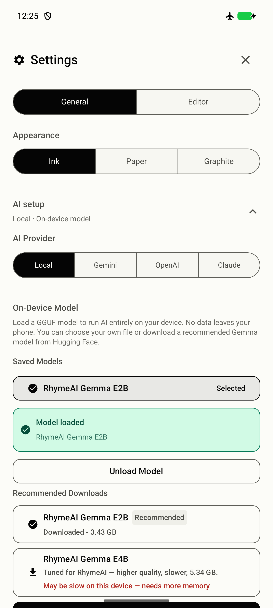

# Combined Android APK: loaded Settings capture

Captured by Rhyme [Android], visually inspected by Rhyme [Lead]. The screenshot contains generic app Settings controls and the Gemma model name; it contains no lyrics, song titles, credentials, account identifiers or user documents. PNG inspection found no text or EXIF metadata. No raw device or instrumentation logs are included.

Source: `5d401dff7af29b97606948fe4e184b56c1b0950d`; tree `c57c4bbfbb5923af54c4d699b3232372269fe4d8`.
Normal APK: SHA-256 `90932d78074720dfc2a8f293a85f2f6c26ed3b72cac4504f723e585a08bd62ba`, package `com.rhymeai.app`, 1.0-ripple (5). Installed readback matched.
Target: owned emulator-5554, Android 17/API 37 ARM64.
Screenshot SHA-256: `e106292f983fb578257e5dda26e57ca1db465128018147978c7ea8a19a97f88d`.

This settled capture verifies visible selected-model, loaded-status and Unload controls. It does not establish transition timing, reduced-motion interactions, memory stability or final release acceptance. Those results remain separately bound in the PR and release record. This evidence-only branch changes no application source.
